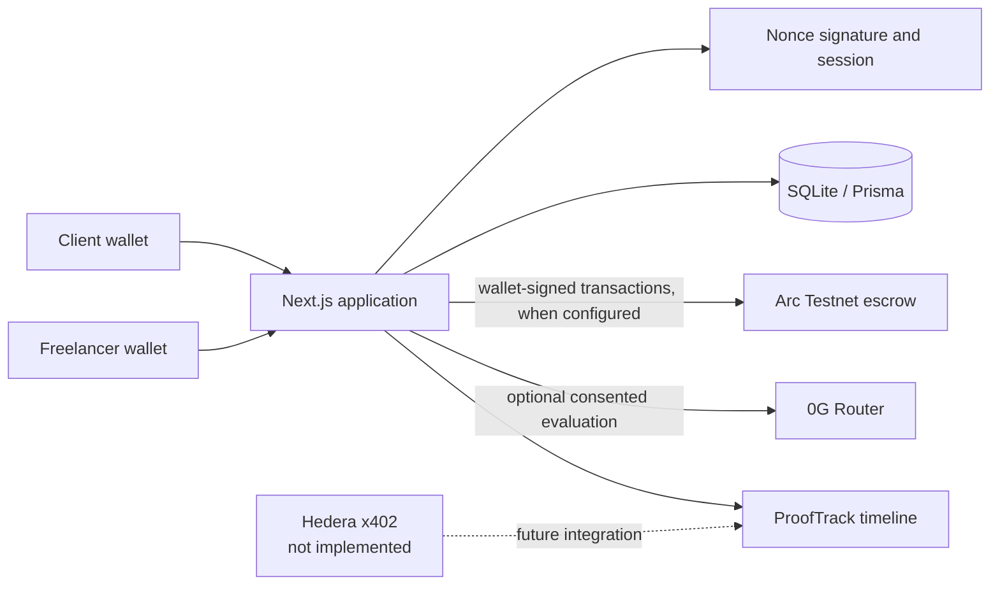

# TRUSTORA

TRUSTORA is a wallet-authenticated workspace for milestone-based work agreements. It helps clients and freelancers agree on criteria, track submissions, and prepare escrow actions where supported. AI evaluation can provide evidence for a human decision, but it cannot release funds.

> **Current status:** local prototype, not a production release. The escrow contract is tested locally but is not deployed/configured; 0G live inference has not been verified; Hedera x402 payment execution is not implemented.

## The problem and approach

Freelance work often starts with vague acceptance terms, while payment disputes leave either party exposed. TRUSTORA connects a wallet-bound agreement and evidence trail to milestone escrow. Project permissions follow the authenticated wallet and stored project roles; selecting a dashboard view never grants permission.

## Architecture



### Technology responsibilities

- **Arc Testnet:** Solidity milestone escrow and USDC settlement. The source, deploy scripts, and local Hardhat tests exist. There is no deployed TRUSTORA contract configured in this checkout.
- **0G:** optional inference provider for structured, advisory evaluation. Provider metadata and request IDs are accepted only from actual provider responses. Tests use mocks; live inference has not been verified.
- **Hedera:** intended for x402 HBAR agent payments. Header parsing, tinybar conversion, policy/verifier helpers, and a persistent budget reservation primitive exist, but the end-to-end payer/facilitator settlement flow is not implemented. No live payment is available.
- **ProofTrack:** application evidence timeline and explorer mapping. Arc event records are marked verified only after receipt, event, actor, identifier, and contract-state checks. There is no public verification portal.

## Stack

- npm workspaces, TypeScript, Next.js 16 App Router, React 18, Wagmi 3, Viem
- Prisma and SQLite for local application data
- Solidity 0.8.24, OpenZeppelin, Hardhat 2
- 0G Router/evaluation, Hedera helper modules, ProofTrack event utilities

## Requirements

- Node.js 20.9 or newer
- npm

## Install and run locally

```bash
npm ci
npx prisma generate --schema apps/web/prisma/schema.prisma
npm run db:update -w @trustora/web
npm run dev
```

The database update command is a dry run unless explicitly told to apply. Review the printed plan before applying a schema update. The web app is served at [http://localhost:3000](http://localhost:3000).

Configuration is optional for browsing and local application work. Copy a safe example template where available and put local values only in ignored `.env` files. Never commit a real key or token.

| Variable | Location | Purpose |
| --- | --- | --- |
| `ESCROW_CONTRACT_ADDRESS` | `apps/web/.env` | Address of an independently deployed escrow; currently not configured by this release |
| `ARC_RPC_URL` | web/contracts env | Optional Arc Testnet RPC override |
| `ZG_ROUTER_API_KEY` | `apps/web/.env` | Optional 0G Router credential; without a valid provider result evaluation is unavailable |
| `ZG_ROUTER_BASE_URL`, `ZG_ROUTER_MODEL`, `ZG_ROUTER_TRUST_MODE`, `ZG_ROUTER_PROVIDER_ADDRESS` | `apps/web/.env` | Optional router configuration supported by the application |
| `DEPLOYER_PRIVATE_KEY` | `packages/contracts/.env` | Testnet deployer only; never needed by the web application or local contract tests |
| `ARC_USDC_ADDRESS` | `packages/contracts/.env` | Optional deployment-time token override, checked by preflight |

See [deployment instructions](docs/DEPLOYMENT.md) for operator-controlled deployment steps. Do not put real credentials in this README or in source code.

## Tests and checks

```bash
npm test
npm run compile:contracts
npx tsc --noEmit -p apps/web/tsconfig.json
npm run build
npm audit --omit=dev
```

`npm test` runs unit/API tests and the Hardhat escrow suite. The current suite has 184 unit/API tests and 14 local contract tests. External RPC/provider responses are mocked in tests; these results do not demonstrate live Arc, 0G, or Hedera transactions. CI runs the same checks on pushes and pull requests.

The production dependency audit currently reports zero findings. The complete `npm audit` also reports 49 development/tooling findings (19 low, 19 moderate, 11 high), concentrated in the existing Hardhat 2 dependency tree. They are not hidden; a separate Hardhat major migration is needed to address that toolchain safely.

## Demonstration workflow

1. Sign in with Wallet A and create a project with milestones and acceptance criteria.
2. Invite Wallet B by its address.
3. Sign in with Wallet B, review the criteria, accept the agreement, and submit a deliverable.
4. Return to Wallet A to review the submission, request revision, or inspect evaluation status.
5. Show that AI results are advisory and that unavailable providers return `UNABLE_TO_ASSESS`.

The client/freelancer application workflow is covered by API tests. Arc funding/release requires an independently deployed contract and real wallet-signed testnet transactions; no deployment is configured here. Do not describe mocked results or local Hardhat transactions as live testnet activity. See [the demo guide](docs/DEMO_SCRIPT.md).

## Deployment

Arc deployment is a manual operator action. First compile and run the local tests, inspect the deployment preflight, and independently verify the resulting contract before adding its address to local configuration. This repository's release-readiness work did not deploy, broadcast, or transfer assets. See [DEPLOYMENT.md](docs/DEPLOYMENT.md) and [ARC_MIGRATION.md](docs/ARC_MIGRATION.md).

## Limitations

- No configured TRUSTORA Arc escrow deployment or live escrow transactions.
- No live 0G inference verified for this release.
- Hedera x402 facilitator-backed HBAR execution and persistent spending limits are not implemented.
- No public ProofTrack verification portal.
- SQLite fixed-window limits cover nonce issuance and authenticated mutation routes. This is not a network-wide edge limit; forwarded-address trust and production load behavior need review.
- No production database operations, monitoring, independent security audit, or production incident process.
- Full development dependency audit has outstanding Hardhat toolchain findings.

## Project documentation

- [Architecture](docs/ARCHITECTURE.md)
- [Integration status](docs/INTEGRATION_STATUS.md)
- [Security status and reporting](docs/SECURITY.md)
- [Project status](docs/PROJECT_STATUS.md)
- [Build checklist](docs/BUILD_CHECKLIST.md)
