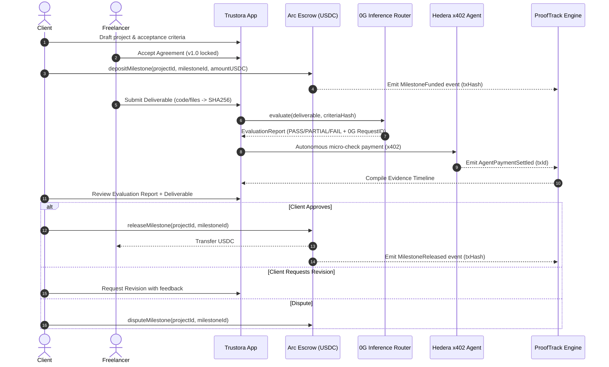

# TRUSTORA — System Architecture

**Tagline:** Trust Every Transaction. Secure Every Promise.  
**Version:** 2.0 (Arc + 0G + Hedera + ProofTrack)

---

## 1. Architectural Philosophy

TRUSTORA is designed as a **programmable trust infrastructure** bridging smart-contract financial guarantees, verifiable AI evaluation, and autonomous machine-to-machine payments.

### Fundamental Invariant
> **"AI must never independently release escrow funds."**  
> AI evaluation is strictly an advisory aid for human counter-parties. The smart contract requires authorized cryptographic signatures from the human client (or designated arbiter during disputes) to disburse escrowed capital.

```
+-----------------------------------------------------------------------------------+
|                                TRUSTORA PLATFORM                                  |
|                                                                                   |
|  AGREE           FUND          WORK          EVALUATE      VERIFY      RELEASE    |
|    |              |              |              |             |           |       |
|    v              v              v              v             v           v       |
| Agreement    Arc Testnet     Freelancer     0G Private     ProofTrack   Arc Escrow|
| Intelligence Escrow Lock    Deliverable    Computer        Evidence     Release to|
| (Criteria)   (USDC 6 dec)   (SHA-256)      (Advisory)     Correlation  Freelancer|
+-----------------------------------------------------------------------------------+
```

---

## 2. Core Ecosystem Pillars

### A. Arc Testnet — Primary Escrow
* **Role:** Custody of milestone funds, multi-milestone lockup, conditional release, dispute resolution, refund processing.
* **Network Parameters:**
  * Network: Arc Testnet
  * Chain ID: `5042002`
  * RPC: `https://rpc.testnet.arc.io`
  * Explorer: `https://explorer.testnet.arc.io`
  * Native Gas: USDC
  * Official USDC ERC-20: `0x3600000000000000000000000000000000000000` (6 decimals)
* **Contract:** `TrustoraEscrow.sol`
  * Reentrancy guard, OpenZeppelin `SafeERC20`, pausable, multi-milestone data structure.
  * Explicit state machine: `Created` -> `Funded` -> `Submitted` -> `Approved` / `RevisionRequested` / `Disputed` -> `Released` / `Refunded`.

### B. 0G — Verifiable AI Deliverable Evaluation
* **Role:** Automated deliverable evaluation against agreed criteria version.
* **Technology:** 0G Private Computer / 0G Inference Router (`router-api-testnet.integratenetwork.work/v1`) with TEE verification headers.
* **Safety & Prompt Isolation:**
  * Delimited random session nonces to prevent deliverable prompt injection.
  * Sanitization of unicode control characters and invisibles.
  * Rigid schema validation (Zod): Output must strictly evaluate agreed criteria with findings and evidence quotes.
  * Explicit disclaimer: `ADVISORY_ONLY_CANNOT_RELEASE_FUNDS`.

### C. Hedera — Autonomous AI-Agent Payments
* **Role:** Micro-payments for specialized third-party agent services (e.g., deep vulnerability scan, specialized code linting) using the **x402** HTTP payment standard on Hedera testnet.
* **Safety Envelope:**
  * Strict allowlist of provider URLs and account IDs.
  * Fixed per-task budget cap and daily spending ceilings.
  * Independent settlement verification on Hedera Mirror Node / HashScan.

### D. Trustora ProofTrack — Multi-Ecosystem Event Correlation
* **Role:** Tamper-evident, unified audit timeline correlating external and on-chain records for every project.
* **Event Taxonomy:**
  1. `BLOCKCHAIN_TRANSACTION_HASH` (Arc Escrow deposit/release)
  2. `INFERENCE_REQUEST_ID` (0G AI evaluation)
  3. `STORAGE_REFERENCE` (0G Storage / IPFS deliverable hashes)
  4. `FACILITATOR_SETTLEMENT_ID` (Hedera agent payment settlement)
  5. `APPLICATION_EVENT_ID` (Agreement acceptance, revision requests)
* **Distinction:** Application-level cryptographic correlation, NOT an atomic cross-chain bridge.

---

## 3. Data Flow & State Machine



---

## 4. Modular Monolith Architecture

The application is structured as a clean modular monolith:
* `apps/web`: Next.js 15 (App Router), Wagmi, Viem, Tailwind CSS, Shadcn UI.
* `packages/contracts`: Hardhat project for `TrustoraEscrow.sol`, deployment scripts, and test suite.
* `packages/og`: 0G Private Computer and Router integration with TEE verification parsing.
* `packages/evaluation`: ProofScore deliverable analysis, prompt injection defenses, and schema validation.
* `packages/hedera`: Autonomous agent x402 payment coordinator, policy engine, and settlement verifier.
* `packages/prooftrack`: Evidence event correlation, verification proofs, and explorer linking.

