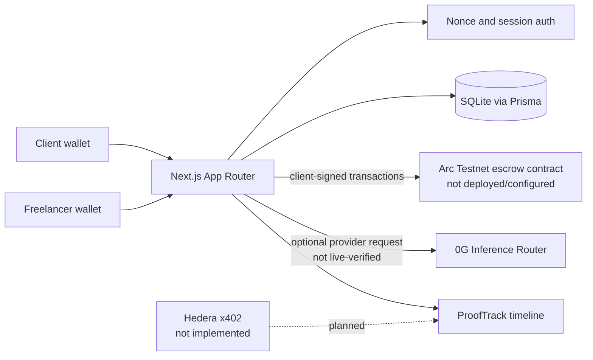

# TRUSTORA architecture

TRUSTORA is a modular monorepo for wallet-authenticated milestone agreements and escrow. Its implemented application path combines off-chain project records, client-signed Arc transactions when configured, optional advisory 0G evaluation, and application evidence records.

## Components

- `apps/web`: Next.js 16 App Router, React 18, Wagmi 3, Viem, Prisma, and SQLite. Wallet sessions establish identity; database records determine client, freelancer, and arbiter access. SQLite fixed-window throttles cover nonce issuance and authenticated mutations; these are not a general edge/network rate limiter.
- `packages/contracts`: Solidity `TrustoraEscrow`, Hardhat configuration, Arc testnet parameters, deployment preflight/deployment scripts, and local contract tests. The contract is tested locally but has no deployment address configured in this release.
- `packages/og`: 0G Router and broker clients. Router inference requires credentials and a genuine provider response/request ID. No live inference was verified. Broker fallback is not equivalent to live 0G inference.
- `packages/evaluation`: criterion-bound structured evaluation, output validation, advisory verdicts, and prompt-injection resistance. Tests use controlled mock providers.
- `packages/hedera`: x402 parsing, tinybar conversion, policy/Mirror Node verification helpers, and an application persistent reservation helper. These are primitives; end-to-end facilitator-backed HBAR payments are not implemented, and the reservation helper is not yet part of a settled payment workflow.
- `packages/prooftrack`: event taxonomy, sequence/timeline helpers, and explorer URL mapping. Arc events receive verified status only through the application's independent receipt/event/state checks. There is no public verification portal.

## Workflow and trust boundaries

1. The client creates a project and criteria. Wallet identity comes from a nonce-verified session.
2. The assigned freelancer accepts the agreement with a wallet signature. Database role checks gate application actions.
3. The client may register and fund milestones through wallet-signed Arc transactions only when a valid escrow address is configured. Server verification reads receipts and contract state; it does not submit user transactions.
4. The freelancer submits work. The application stores a SHA-256 digest and can anchor it on-chain when Arc is configured.
5. The client may request an advisory 0G evaluation. Evaluation cannot call escrow methods or authorize payment.
6. The client decides whether to release; an authorized arbiter can resolve a dispute through the contract. The browser wallet signs either transaction.

## Evidence levels

| Evidence | Meaning |
| --- | --- |
| Arc `VERIFIED` event | Receipt, contract address, expected log, transaction roles/identifiers, and contract state were independently checked by application code. No live deployment is currently configured. |
| 0G request ID/report | Provider response evidence; a request ID is not a blockchain transaction or independent proof of model correctness. Current tests mock providers. |
| Application event | Database-backed workflow record; not independently anchored unless accompanied by a separately verified chain event. |
| Hedera settlement | Not available: payment execution is not implemented. |

## Technology and runtime

The repository uses npm workspaces. The web app currently targets Node.js 20.9 or newer for Next.js 16, Solidity 0.8.24, Arc Testnet chain ID 5042002, and SQLite/Prisma. See the root README for setup and tested commands.
